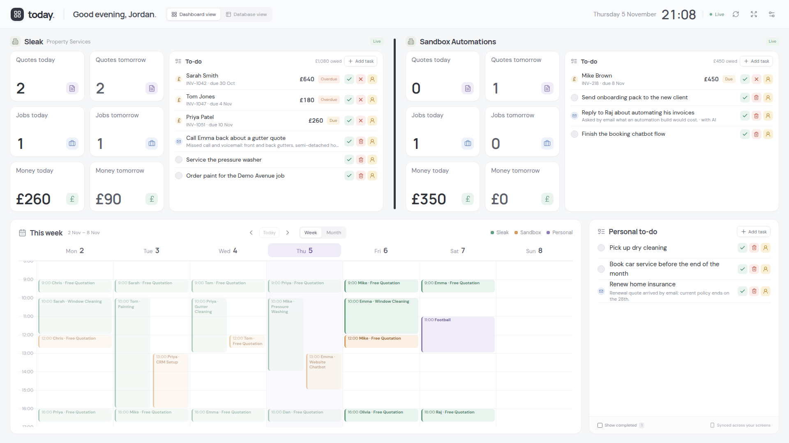
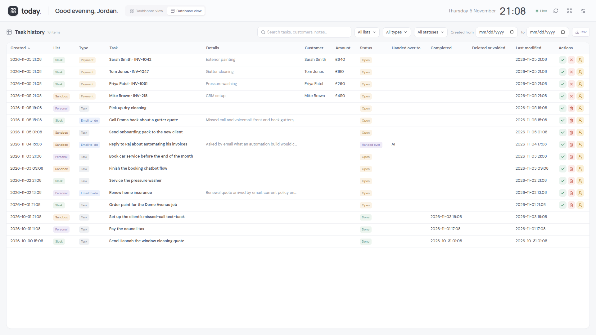
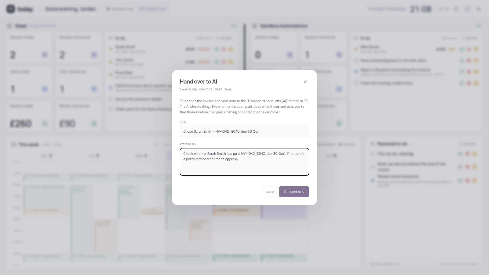
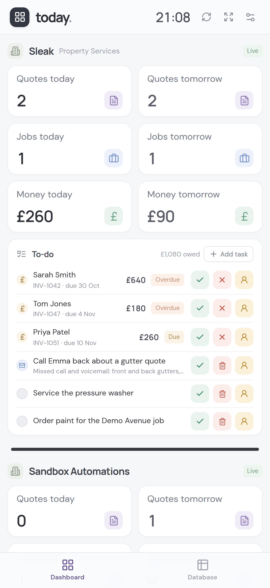
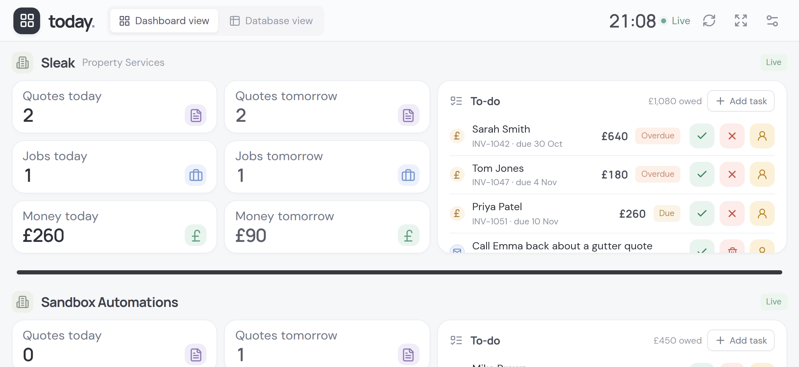
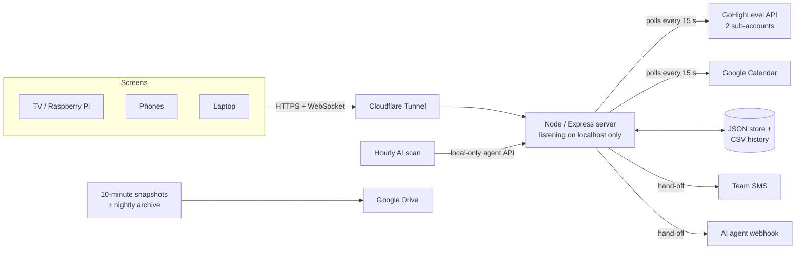

# Live TV Dashboard: case study

A live dashboard I designed and run every day to manage two small businesses and my
personal life from one screen: a TV on the wall, my phone and my laptop, all updating at
once.



> **About this repository.** The dashboard is connected to live business systems
> (bookings, invoices, customer messages), so its source code is kept private. This
> repository explains what it does, how it's built and how it has changed over time. All
> screenshots come from the built-in demo mode, so every name, booking and amount is made
> up. I'm happy to walk through the code in an interview.

## The problem

I run a property services company (Sleak Property Services) and an automation agency
(Sandbox Automations). Each business has its own CRM sub-account, its own bookings and its
own unpaid invoices. On top of that I have a personal calendar and to-do list, and email
and messages arrive all day. Answering simple questions meant checking several apps:

- How many quotes and jobs do I have today and tomorrow, and what are they worth?
- Who still owes money?
- What does each business need from me next?

## What I built

One screen that answers all of that at a glance and lets me act on it straight away.

- **Two businesses side by side.** Each has six metric bubbles (quotes, jobs and money for
  today and tomorrow), worked out from GoHighLevel service bookings and opportunity values.
- **One to-do list per business.** Unpaid invoices sit alongside ordinary tasks, and an
  invoice can be marked paid or voided in one tap. The server re-reads the invoice first
  and asks for confirmation, so a stale screen can never pay the wrong amount.
- **Hand-offs.** Any item can be passed to a team member, who gets an SMS from that
  business's number, or to an AI agent. The AI works on it and asks me before changing
  anything or contacting anyone.
- **A unified calendar** blending both businesses' bookings with my Google Calendar,
  colour-coded and de-duplicated. The CRM mirrors calendars into each other, so most raw
  events are duplicates.
- **An AI to-do scan** that reads new email and customer messages every hour and adds
  anything that needs doing. A to-do I delete never comes back.
- **A permanent history** of every task and invoice event, in a sortable, filterable
  Database view and as CSV.
- **Native phone layouts** for portrait and landscape, installable to the iPhone Home Screen.

| Database view                                 | Handing an invoice to the AI                          |
| --------------------------------------------- | ----------------------------------------------------- |
|  |  |

| iPhone, portrait                                                                   | iPhone, landscape                                                                    |
| ---------------------------------------------------------------------------------- | ------------------------------------------------------------------------------------ |
|  |  |

## Architecture



**Stack:** React 19, Vite, Node 24, Express 5, WebSockets, systemd, Cloudflare Tunnel,
restic and rclone, with the GoHighLevel and Google Calendar, Gmail and Drive APIs.

### Decisions worth explaining

- **One server owns every integration.** Screens never hold a token. They receive one
  snapshot of state over a WebSocket whenever anything changes, and poll every 5 seconds if
  the connection drops.
- **A JSON file, not a database.** At this scale (one household, two businesses) a
  database would add operations work for no benefit. Writes are atomic: a temporary file,
  then a rename. History goes to an append-only event log, so nothing is ever lost.
- **No open ports.** The server only listens on localhost. A Cloudflare Tunnel carries
  traffic in, so nothing on the server is reachable from the internet directly.
- **Demo mode goes through the real code.** Made-up raw data is fed through the same
  functions that clean up live API responses, so demo screens behave exactly like the real
  thing. Paying, voiding and hand-offs are switched off in demo mode, and a test proves it.

## Security

- **Sign-in:** a long random access key, typed once per device, or a one-time link for a
  TV. Links expire after 30 minutes and need a tap to use. Message apps open links to build
  previews, and that used to use them up.
- **Brute-force protection:** three wrong keys block that network. It uses the visitor's
  real address as reported by Cloudflare, and blocks the whole /64 range for IPv6 so an
  attacker can't just switch address.
- **Sessions:** random 256-bit tokens in `HttpOnly`, `Secure`, `SameSite` cookies.
- **Requests:** changes must come from the dashboard's own origin as JSON, and pages can't
  be framed by other sites.
- **Device control:** everyone signed in can see which devices are signed in, but only the
  server itself can sign one out. The management API refuses anything that arrives through
  the tunnel.

## Reliability: backups I've actually restored

|       | Every 10 minutes                                    | Every night             |
| ----- | --------------------------------------------------- | ----------------------- |
| How   | restic: deduplicated and encrypted                  | tar + zstd + AES-256    |
| Size  | Only what changed, about 20 MB                      | Complete archive        |
| Kept  | All for a day, hourly for a week, daily for a month | Last 7                  |
| Where | Server and Google Drive                             | Server and Google Drive |

A restore script rebuilds a fresh server from the Google Drive copy. It needs only an
"emergency kit" file kept off the server. I tested it end to end: 2.7 GB restored in about
a minute, with every database passing an integrity check.

Two safeguards came from thinking about failures rather than the normal path:

```js
// A rebuilt server starts a new, empty repository; mirroring that would wipe the
// Drive copy, so only sync when Drive holds this same repository (or nothing yet).
const remote = await rclone(
  ["cat", `gdrive:${DRIVE_FOLDER}/config`],
  drive,
  env,
);
if (remote.code !== 0 && !/not found/i.test(remote.errors))
  throw new Error(`Google Drive check failed: ${remote.errors.slice(-300)}`);
if (remote.code === 0 && !remote.out.equals(readFileSync(join(REPO, "config"))))
  throw new Error(
    "Google Drive holds a different snapshot store, so it was left alone.",
  );
```

```js
const network = (req) => {
  // Through the tunnel every request comes from cloudflared on this machine, and
  // Cloudflare passes on the visitor's real address.
  const peer = String(req.socket.remoteAddress || "").replace(/^::ffff:/, "");
  const ip = (
    (["127.0.0.1", "::1"].includes(peer) && req.get("cf-connecting-ip")) ||
    peer
  ).trim();
  // An IPv6 connection usually has a whole /64 to pick addresses from.
  return ip.includes(":") ? `${expandIpv6(ip).slice(0, 4).join(":")}::/64` : ip;
};
```

## Quality

- 22 automated tests (Node's built-in test runner). They cover the booking classification
  rules, calendar de-duplication, invoices, the history log, and the HTTP and security
  behaviour: sign-in, blocking, origin checks, device control and demo mode.
- Prettier and ESLint clean, with no unused code. Release 1.3.0 removed a leftover
  live-update channel and settings nothing read any more.
- Every change is recorded in the [changelog](CHANGELOG.md), and each release is tagged.

## How I work

I build with AI coding agents (T3 Code, Claude, Codex and Cursor), which I direct, review
and test. I decide what to build and how it should behave, and I check every change in the
real environment before relying on it. Screenshots of every layout are taken
automatically with Playwright, at the exact sizes of the devices I use.

## What's next

- Split the frontend's single component file into feature folders, and move to TypeScript.
- Per-person logins with roles, so staff only see their own business's list.
- Continuous integration (GitHub Actions) running the tests on every push.

## Changes over time

The full history is in [CHANGELOG.md](CHANGELOG.md). In short:

| Version | Date        | Highlights                                                                                                  |
| ------- | ----------- | ----------------------------------------------------------------------------------------------------------- |
| 1.3.0   | 5 Nov 2026  | Demo mode, documentation, dead-code clean-up                                                                |
| 1.2.0   | 3 Nov 2026  | Permanent domain, device list, brute-force blocking, 10-minute off-site snapshots, tested disaster recovery |
| 1.1.0   | 1 Nov 2026  | Native iPhone layouts for portrait and landscape                                                            |
| 1.0.0   | 30 Oct 2026 | Rebuilt around two businesses: live metrics, calendar, invoices, hand-offs, history, AI scan                |
| 0.2.0   | 6 Oct 2026  | Email "needs a reply" sidebar                                                                               |
| 0.1.0   | 2 Oct 2026  | First version on the TV                                                                                     |

---

© 2026 Jordan Leak. All rights reserved. The screenshots and text are shared to show my
work; please don't reuse them.
